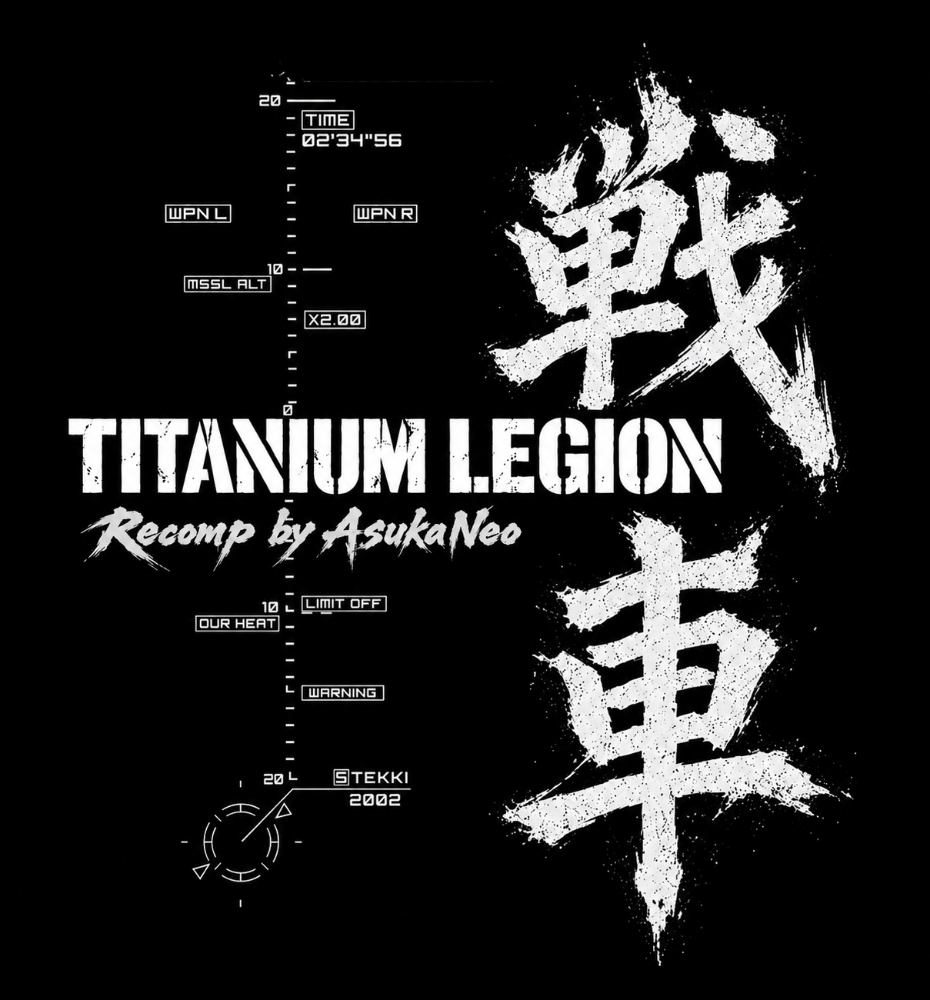
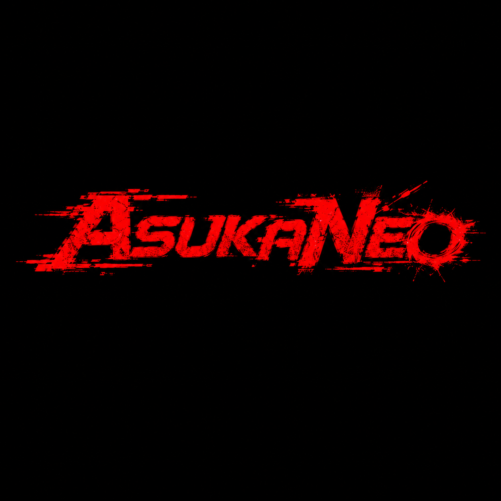

<p align="center">
  
</p>

# Titanium Legion

A static recompilation of *Steel Battalion* (Xbox) on xboxrecomp.

> **Pre-alpha preview.** A build is on the
> [releases page](https://github.com/AsukaNeo/titanium-legion/releases). The
> first mission plays at about 30 fps on a normal pad with
> [Easy Pilot](#easy-pilot), but it is rough: see the known problems under
> [Status](#status).

You need your own copy of the game: `default.xbe` must match SHA-1
`338b3e1022f6e4e6a55aee430e091af8113f660e`. Nothing from the game is in this
repository.

## Status

- Pre-alpha: Campaign and Mission 00 play on a normal pad, with rough edges.
- A virtual Steel Battalion controller sits on port 1 (the toolkit's
  `RECOMP_USB_SB=0`), played from a pad and the keyboard (`src/sb_input.c`).
  The game accepts it and lights its lamps. Main Weapon gets past the title
  into the main menu and Campaign's pilot entry, and Lock On backs out.
- Every button bit and axis has been checked on the game's CONTROLLER
  FUNCTION VERIFICATION screen ([docs/controller.md](docs/controller.md)).
- Campaign works: a new pilot is created and saved, the saved pilot loads
  (LISTED PILOT), Mission 00 loads, the cockpit start-up brings the VT up,
  and it walks (25 km/h in gear 1, mission clock running).
- Missions run without crashing: an unlifted state-dispatch thunk
  (`0x000B0B70`, now seeded) unbalanced the main thread's stack every
  frame until it overwrote the CRT's thread data. Mission 00 plays to its
  end and on into the story scenes and the next sortie.
- Bink movies play.
- The main monitor shows the outside view.
- The cockpit runs at the game's 30 fps (29-30 walking through Mission 00,
  from 6.7), with everything drawn on the GPU: float depth, the depth-only
  shadow pass, the shadow compare and the HUD's lines.
- Frame generation is on by default (`[display] frame_gen`, F10): the game
  runs at its own 30 a second and the window shows made frames up to the
  display's refresh, one game frame later. Pixels the same in both frames stay
  put, so the HUD isn't carried off with a turning world.
- The pad has had one person's hand-testing, on one controller: pilot entry,
  the start-up, walking and aiming. The classic layout, and most of the keyboard
  panel, have only been driven by script.
- Known problems:
  - The second start-up in one run can get stuck at the Start step. Closing the
    game and loading your pilot again gets you back in.
  - The continue menu doesn't draw correctly.
  - The frame rate can drop to the low 20s.
  - With all 8 pilot slots full, or a blank pilot name, the screen dims and
    nothing says why.
  - The shadows have not been compared with real hardware.

## Easy Pilot

The game was built for a 40-button controller with three pedals. Easy Pilot
plays it on a normal pad, and it is on by default: the left stick walks and picks
the gears for you, the triggers fire and lock on, and prompts walk you through
the start-up.

To turn it off, change the **Easy Pilot** row on the title card or in the F10
settings, or press F7. That brings back the classic layout and takes the prompts
away. The choice is remembered as `[controls] scheme` in `titaniumlegion.ini`.

From the title card to walking:

1. Choose **Play**, then press **A** or **Start** at the game's title.
2. Choose **CAMPAIGN**, then **LIST AS NEW** for a new pilot or **LISTED PILOT**
   for a saved one. In menus the left stick or d-pad moves, **A** or **Start**
   accepts, and **X** goes back.
3. For a new pilot, pick each letter of the name and accept it, go down to
   **COMPLETE**, then accept the birth date and **YES**. Pick the mission: the
   pilot is only saved at this point, so quitting earlier loses it.
4. Press **Start** to skip the intro movie.
5. In the cockpit, follow the prompt at the bottom of the screen and press
   **Start** for each step: hatch, ignition, switches and systems.
6. When the five diagnostics bars rise and fall, **hold Start**. It presses for
   you the moment all five are past the marker, and the engine starts.
7. Push the **left stick** up to walk, further for a higher gear. Pull it back to
   brake, and keep it back to reverse.
8. Aim with the **right stick**, fire with **RT** and lock on with **LT**. Hold
   **Tab** or press **RB+Back** for a card of every control.

The right stick starts gently and speeds up towards its edge. If aiming feels too
slow or too fast, set `aim_sensitivity` under `[controls]` in `titaniumlegion.ini`,
from 10 to 100 (the default is 70).

## Starting the VT

A prompt at the bottom of the screen walks you through this, and **Start**
(pad) or **Enter** works whichever step is due: hatch, ignition, all five
switches, Start, and, held at the bars, the engine, pressed for you when all
five are past the marker. The prompts come with Easy Pilot (see below); F8
turns them on or off until the next run. By hand:

1. Close the **cockpit hatch** (H).
2. Press **Ignition** (I). The main monitor shows the five-switch checklist.
3. Flip the **five toggle switches** on (6 7 8 9 0) *while the checklist
   shows*. Switches that were already on don't count: flip them off and on.
4. Press **Start** (Enter). The systems boot: map, diagnostics, the
   sub-monitor's front view.
5. When the Start lamp blinks again, the main monitor shows five
   diagnostics bars (BODY, L_ARM, R_ARM, L_LEG, R_LEG) rising and falling
   past a marker (`^`, about 70). Press **Start** **in neutral with the
   pedals up** at a moment when all five are past the marker: "O.K. WORK
   100%" starts the engine, and the HUD comes up and the mission clock
   runs. Pressed with any bar short of it, the game says "N.G." and the
   bars start over. The bars' lower bound creeps up over time, so waiting
   makes it easier.
6. Shift to **1** (d-pad up or Page Up) and press the **accelerator** (RT).

The game blinks the lamp of the button it wants next (`TL_SB_LAMP_LOG=1`
shows them: lamp 1 is the hatch, 2 Ignition, 3 Start). `TL_SB_PEEK=1` prints
what the game made of the controller every 2 s (its gear, and the virtual
pad it builds from the report).

## Controls

The plan is a keyboard and gamepad experience first: the pad flies the VT
and the keyboard works the panel, so the game can be played without its
original controller. Later, the hope is to find a way to support the
original controller itself, and HOTAS-style setups (stick, throttle and
pedals) mapped onto the same virtual controller.

Hold Tab, or press RB+Back, for a card of all of it in the game.

On the pad, Easy Pilot, once the engine is running. It is on by default. Turn
it off for the classic layout below, without the prompts, on the title card, in
the F10 settings or with F7; the choice is remembered as `[controls] scheme` in
`titaniumlegion.ini`.

| Pad | Controller |
|---|---|
| Left stick up | Walk: the gears follow the stick's travel, a gear at a time |
| Left stick down | Brake, then after about a second reverse |
| Left stick left / right | Rotation lever |
| Right stick | Aiming lever |
| RT / LT / LB | Main weapon / Lock on / Slide step |
| A | Sub weapon (Fire) |
| X / B / Y | Weapon con main / sub / Magazine change |
| D-pad up / down | Map zoom / Sub monitor mode |
| D-pad left / right | Main monitor zoom in / out |
| RB + right stick | Sight change |
| RB + A / B / X / Y | Chaff / Extinguisher / Night scope / Override |
| Left / right stick click | Washing / Sight change |
| Back | Multi-monitor open-close |

The start-up uses the classic layout, and the menus have their own moves (below
the tables).

On the pad, the classic layout, the fight:

| Pad | Controller |
|---|---|
| Left stick X | Rotation lever |
| Left stick Y | Sight change up / down (also moves the menus) |
| Right stick | Aiming lever |
| RB + right stick | Sight change |
| LB / LT / RT | Left (slide step) / middle (brake) / right (accelerator) pedal |
| A / B / X / Y | Main weapon / Fire / Lock on / Magazine change |
| RB + A / B / X / Y | Chaff / Extinguisher / Night scope / Override |
| D-pad up / down | Gear up / down (R, N, 1-5) |
| D-pad left / right | Main monitor zoom in / out |
| Start | The next start-up step, or Start |
| Back | Multi-monitor open-close |
| RB + Back | The controls card |
| RB + Start | Pilot view |
| Left / right stick click | Washing / Sight change |

On the keyboard, the panel:

| Key | Controller |
|---|---|
| H, I | Cockpit hatch, Ignition |
| Enter | The next start-up step, or Start |
| Tab (hold) | The controls card |
| F9 | Pilot view: the main monitor fills the window, without the lower panel |
| F8 | Prompts on / off |
| F7 | Easy Pilot on / off |
| Shift+Backspace | Eject |
| 6 7 8 9 0 | Toggle switches: filter control, oxygen supply, fuel flow rate, buffer material, VT location |
| 1-5 | Comm 1-5 |
| [ and ] | Tuner dial |
| Page Up / Page Down | Gear up / down |
| Q, E, R | Weapon con main, sub, magazine |
| M, N, B, V | Multi-monitor open-close, map zoom, mode select, sub monitor |
| F, G, C, T | FSS, manipulator, line colour change, tank detach |
| W, X, Z, O, L | Washing, extinguisher, chaff, override, night scope |
| F1-F3 | F1-F3 |
| Space | Main weapon |
| Arrow keys | Sight-change stick (moves the menus) |

In the menus, the left stick, the d-pad or the arrow keys move, A, Start, Enter
or Space accepts, and X or Backspace goes back. At pilot entry, pick each letter
of the name and press accept, go down to COMPLETE and accept, then accept the
birth date and YES.

For scripted runs, `TL_SB_SCRIPT="<ms>:<control>[+<control>][:<hold>],..."`
(or `@file`) works the controller on a timeline. Controls are bit numbers,
`AXP AXN AYP AYN` (aiming lever), `ROTP ROTN`, `SXP SXN SYP SYN` (sight
change), `PL PM PR` (pedals), `GR GN G1`-`G5` (gear) and `T<n>` (tuner).
`TL_SB_LAMP_LOG=1` logs the lamps. `TL_SB_LIVE=<file>` presses each line
appended to the file while the game runs (`CLEAR` lets go of everything
held; a hold over a second is a latch and doesn't hold up the next line).

## Building

The toolkit sits next to this folder in `../xboxrecomp`: upstream
[xboxrecomp](https://github.com/sp00nznet/xboxrecomp) v0.16.0 with
`patches/xboxrecomp-local.patch` applied. The patch is Aggro Royale's, plus
the Steel Battalion controller in `src/usb/usb_gamepad.c` (and a guard in
`ohci.c` so its lamp report isn't taken for rumble), cooperative thread
suspend, FATX overwrite semantics, the infinite-w clamp for the Bink movies,
16-bit colour targets, float depth, depth-only passes and the shadow compare
on the GPU, and the neighbouring-texture case in `nv2a_gpu_d3d11.cpp`.

```bash
git clone -b v0.16.0 https://github.com/sp00nznet/xboxrecomp ../xboxrecomp
```

```bash
git -C ../xboxrecomp apply ../titanium-legion/patches/xboxrecomp-local.patch
```

The game goes in `game/` (`default.xbe` and `Media`), from your own disc.

In Git Bash:

```bash
./lift.sh
```

```bash
cmake -S . -B build -A x64
```

```bash
cmake --build build --config Release --parallel
```

`./run.sh <name> [watchdog s] [kill after s]` runs the build with its log in
`logs/<name>.log`. For screenshots, set `RECOMP_SCREENSHOT_EVERY=<seconds>`;
they land in `screenshots/`.

## Notes for this title

- `RECOMP_ASYNC_IO=1` is built in. The loader reads its first archive through an
  asynchronous handle and only finishes if the read went pending. A read
  answered synchronously hangs it forever at `0x000C84C1`.
- D3D's device pointer is `0x0021AFE0`; the fence fields are at +0x30/+0x34
  (XDK 4627, as in Aggressive Inline). BlockOnFence starts at `0x00211E11`.
- `seg00`-`seg50` are mission data loaded with `XeLoadSection`, not code.
- The engine-start check is `sub_0008A970`: bars at `0x55D8DC` (five
  floats) swing between a floor (`0x55D8B4`) and a jittering cap
  (`0x55D8C8`); Start succeeds when all five are at or above the marker at
  `0x55D984`.
- `0x000B0B30`/`B50`/`B70` are thunks that jump through a five-state table
  (`[obj+0x15E]`) at `0x2DCE28`/`3C`/`50`. They're reached only through an
  object's update pointer (`+0x14C`), so the sweep misses them; they're
  seeded.
- The whole depth buffer is float Z16 (control0 bit 12, range 0-511.9375). The
  shadow map is one too, 2048x2048 with no colour target, sampled as format
  0x31 in a projective stage with `SET_SHADOW_DEPTH_FUNC` 4: lit where the
  map's depth is greater than the coordinate's. The back end holds float Z16
  as z/511.9375 in D32_FLOAT and never reads it back to guest memory. The
  pass biases itself with polygon offset, so `RECOMP_POFS=1` is built in.
- The HUD is drawn with lines. `RECOMP_GPU_LINES=1` (built in) sends them to
  the GPU; on the CPU each batch wrote every GPU surface back to guest memory.
- The main monitor is composited into a 512x512 target from the view
  (another 512x512 target) and a 200x200 noise target whose last rows run
  into the composite target's first ones (pitch 832, packed 0x28000 bytes
  apart). The toolkit's D3D11 back end used to refuse that as feedback and
  send the composite to the CPU, which drew grey static; it now lets a
  texture that only runs into a target's first rows through. Whether the
  two land next to each other depends on the heap, so it came and went
  between runs.

## Credits

- **[xboxrecomp](https://github.com/sp00nznet/xboxrecomp)** by sp00nz and contributors, the base this project is built on
- **[xemu](https://github.com/xemu-project/xemu)**, the reference for Xbox hardware behaviour (see [NOTICE](NOTICE))
- **[Exonerated](https://github.com/AsukaNeo/Exonerated)**, the *Deathrow* port this one follows
- A professional coder's input throughout

## AI assistance

AI (**Claude Opus 5.5**) was used as a development assistant for the intensely time-consuming recompilation work, to make this project a reality sooner. Human-made decompilation projects are the gold standard. View the use of AI in this project in whatever way feels most appropriate to you.

## Legal

MIT licence (see [LICENSE](LICENSE) and [NOTICE](NOTICE)), covering this project's own code only. Titanium-Legion is an independent fan project, not affiliated with the rights holders of *Steel Battalion*, or with Microsoft. Those games, their music, Xbox and related marks belong to their owners. No game code, data, music or assets are included: the program and its setup work only from your own copies.

<p align="center">
  
</p>
