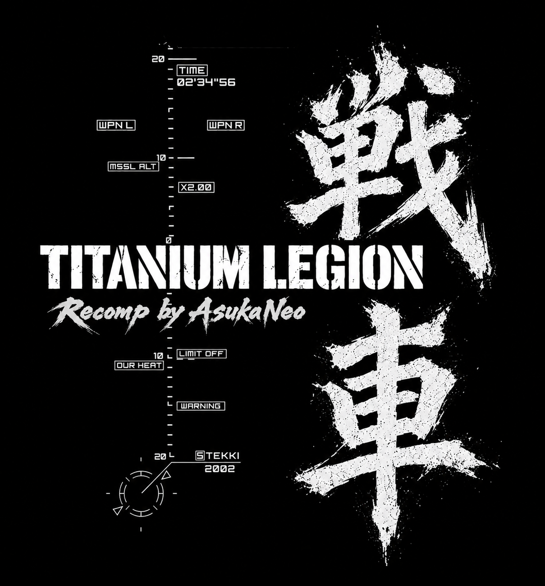

<p align="center">
  
</p>

# Titanium Legion

A static recompilation of *Steel Battalion* (Xbox) on xboxrecomp.

> **Pre-alpha.** There are no builds. It reaches the first mission and plays
> it, but at 5-7 fps in the cockpit, and the controls have only been driven
> by script. Not playable yet.

You need your own copy of the game: `default.xbe` must match SHA-1
`338b3e1022f6e4e6a55aee430e091af8113f660e`. Nothing from the game is in this
repository.

## Status

- Boots, but not yet playable.
- A virtual Steel Battalion controller sits on port 1 (the toolkit's
  `RECOMP_USB_SB=0`), played from a pad and the keyboard (`src/sb_input.c`).
  The game accepts it and lights its lamps. Main Weapon gets past the title
  into the main menu and Campaign's pilot entry, and Lock On backs out.
- Every button bit and axis has been checked on the game's CONTROLLER
  FUNCTION VERIFICATION screen ([docs/controller.md](docs/controller.md)).
- Campaign works: a new pilot is created and saved, the saved pilot loads
  (LISTED PILOT), Mission 00 loads, the cockpit start-up brings the VT up,
  and it walks (25 km/h in gear 1, mission clock running).
- Missions run without crashing: an unlifted state-dispatch thunk
  (`0x000B0B70`, now seeded) unbalanced the main thread's stack every
  frame until it overwrote the CRT's thread data. Mission 00 plays to its
  end and on into the story scenes and the next sortie.
- Bink movies play.
- The main monitor shows the outside view.
- Open: 5-7 fps in the cockpit. Nearly all the drawing left on the CPU is
  the shadow map (a depth-only pass into a 2048x2048 float Z16 buffer, then
  sampled with the NV2A's depth compare) and the cockpit's quads, refused
  for float depth; the GPU back end has neither yet. The pad and keyboard
  have only been driven by script, not by hand.

## Starting the VT

1. Close the **cockpit hatch** (H).
2. Press **Ignition** (I). The main monitor shows the five-switch checklist.
3. Flip the **five toggle switches** on (6 7 8 9 0) *while the checklist
   shows*. Switches that were already on don't count: flip them off and on.
4. Press **Start** (Enter). The systems boot: map, diagnostics, the
   sub-monitor's front view.
5. When the Start lamp blinks again, the main monitor shows five
   diagnostics bars (BODY, L_ARM, R_ARM, L_LEG, R_LEG) rising and falling
   past a marker (`^`, about 70). Press **Start** **in neutral with the
   pedals up** at a moment when all five are past the marker: "O.K. WORK
   100%" starts the engine, and the HUD comes up and the mission clock
   runs. Pressed with any bar short of it, the game says "N.G." and the
   bars start over. The bars' lower bound creeps up over time, so waiting
   makes it easier.
6. Shift to **1** (d-pad up or Page Up) and press the **accelerator** (RT).

The game blinks the lamp of the button it wants next (`TL_SB_LAMP_LOG=1`
shows them: lamp 1 is the hatch, 2 Ignition, 3 Start). `TL_SB_PEEK=1` prints
what the game made of the controller every 2 s (its gear, and the virtual
pad it builds from the report).

## Controls

The plan is a keyboard and gamepad experience first: the pad flies the VT
and the keyboard works the panel, so the game can be played without its
original controller. Later, the hope is to find a way to support the
original controller itself, and HOTAS-style setups (stick, throttle and
pedals) mapped onto the same virtual controller.

On the pad, the fight:

| Pad | Controller |
|---|---|
| Left stick X | Rotation lever |
| Left stick Y | Sight change up / down (also moves the menus) |
| Right stick | Aiming lever |
| RB + right stick | Sight change |
| LB / LT / RT | Left (slide step) / middle (brake) / right (accelerator) pedal |
| A / B / X / Y | Main weapon / Fire / Lock on / Magazine change |
| RB + A / B / X / Y | Chaff / Extinguisher / Night scope / Override |
| D-pad up / down | Gear up / down (R, N, 1-5) |
| D-pad left / right | Main monitor zoom in / out |
| Start / Back | Start / Multi-monitor open-close |
| Left / right stick click | Washing / Sight change |

On the keyboard, the panel:

| Key | Controller |
|---|---|
| H, I, Enter | Cockpit hatch, Ignition, Start |
| Shift+Backspace | Eject |
| 6 7 8 9 0 | Toggle switches: filter control, oxygen supply, fuel flow rate, buffer material, VT location |
| 1-5 | Comm 1-5 |
| [ and ] | Tuner dial |
| Page Up / Page Down | Gear up / down |
| Q, E, R | Weapon con main, sub, magazine |
| M, N, B, V | Multi-monitor open-close, map zoom, mode select, sub monitor |
| F, G, C, T | FSS, manipulator, line colour change, tank detach |
| W, X, Z, O, L | Washing, extinguisher, chaff, override, night scope |
| F1-F3 | F1-F3 |
| Space | Main weapon |
| Arrow keys | Sight-change stick (moves the menus) |

In the menus, Main Weapon (A or Space) accepts and Lock On (X) goes back.

For scripted runs, `TL_SB_SCRIPT="<ms>:<control>[+<control>][:<hold>],..."`
(or `@file`) works the controller on a timeline. Controls are bit numbers,
`AXP AXN AYP AYN` (aiming lever), `ROTP ROTN`, `SXP SXN SYP SYN` (sight
change), `PL PM PR` (pedals), `GR GN G1`-`G5` (gear) and `T<n>` (tuner).
`TL_SB_LAMP_LOG=1` logs the lamps. `TL_SB_LIVE=<file>` presses each line
appended to the file while the game runs (`CLEAR` lets go of everything
held; a hold over a second is a latch and doesn't hold up the next line).

## Building

The toolkit sits next to this folder in `../xboxrecomp`: upstream
[xboxrecomp](https://github.com/sp00nznet/xboxrecomp) v0.16.0 with
`patches/xboxrecomp-local.patch` applied. The patch is Aggro Royale's, plus
the Steel Battalion controller in `src/usb/usb_gamepad.c` (and a guard in
`ohci.c` so its lamp report isn't taken for rumble), cooperative thread
suspend, FATX overwrite semantics, the infinite-w clamp for the Bink movies,
16-bit colour targets on the GPU, and the neighbouring-texture case in
`nv2a_gpu_d3d11.cpp`.

```bash
git clone -b v0.16.0 https://github.com/sp00nznet/xboxrecomp ../xboxrecomp
```

```bash
git -C ../xboxrecomp apply ../titanium-legion/patches/xboxrecomp-local.patch
```

The game goes in `game/` (`default.xbe` and `Media`), from your own disc.

In Git Bash:

```bash
./lift.sh
```

```bash
cmake -S . -B build -A x64
```

```bash
cmake --build build --config Release --parallel
```

`./run.sh <name> [watchdog s] [kill after s]` runs the build with its log in
`logs/<name>.log`. For screenshots, set `RECOMP_SCREENSHOT_EVERY=<seconds>`;
they land in `screenshots/`.

## Notes for this title

- `RECOMP_ASYNC_IO=1` is built in. The loader reads its first archive through an
  asynchronous handle and only finishes if the read went pending. A read
  answered synchronously hangs it forever at `0x000C84C1`.
- D3D's device pointer is `0x0021AFE0`; the fence fields are at +0x30/+0x34
  (XDK 4627, as in Aggressive Inline). BlockOnFence starts at `0x00211E11`.
- `seg00`-`seg50` are mission data loaded with `XeLoadSection`, not code.
- The engine-start check is `sub_0008A970`: bars at `0x55D8DC` (five
  floats) swing between a floor (`0x55D8B4`) and a jittering cap
  (`0x55D8C8`); Start succeeds when all five are at or above the marker at
  `0x55D984`.
- `0x000B0B30`/`B50`/`B70` are thunks that jump through a five-state table
  (`[obj+0x15E]`) at `0x2DCE28`/`3C`/`50`. They're reached only through an
  object's update pointer (`+0x14C`), so the sweep misses them; they're
  seeded.
- The main monitor is composited into a 512x512 target from the view
  (another 512x512 target) and a 200x200 noise target whose last rows run
  into the composite target's first ones (pitch 832, packed 0x28000 bytes
  apart). The toolkit's D3D11 back end used to refuse that as feedback and
  send the composite to the CPU, which drew grey static; it now lets a
  texture that only runs into a target's first rows through. Whether the
  two land next to each other depends on the heap, so it came and went
  between runs.

## Credits

- **[xboxrecomp](https://github.com/sp00nznet/xboxrecomp)** by sp00nz and contributors, the base this project is built on
- **[xemu](https://github.com/xemu-project/xemu)**, the reference for Xbox hardware behaviour (see [NOTICE](NOTICE))
- **[Exonerated](https://github.com/AsukaNeo/Exonerated)**, the *Deathrow* port this one follows
- A professional coder's input throughout

## AI assistance

AI (**Claude Opus 5.5**) was used as a development assistant for the intensely time-consuming recompilation work, to make this project a reality sooner. Human-made decompilation projects are the gold standard. View the use of AI in this project in whatever way feels most appropriate to you.

## Legal

MIT licence (see [LICENSE](LICENSE) and [NOTICE](NOTICE)), covering this project's own code only. Titanium-Legion is an independent fan project, not affiliated with the rights holders of *Steel Battalion*, or with Microsoft. Those games, their music, Xbox and related marks belong to their owners. No game code, data, music or assets are included: the program and its setup work only from your own copies.

<p align="center">
  
</p>
